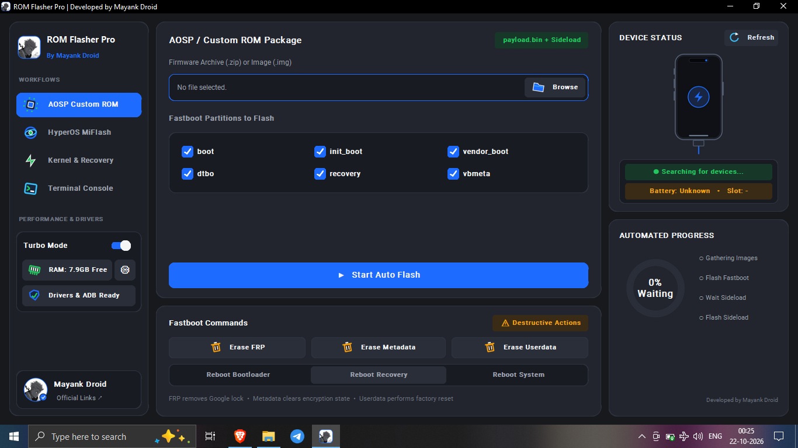
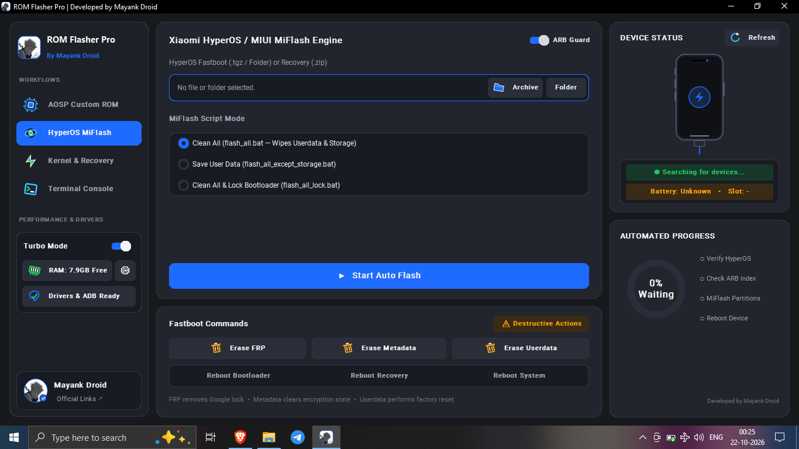
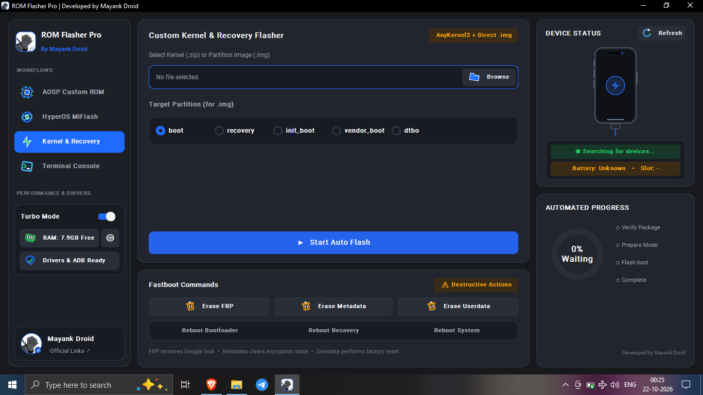
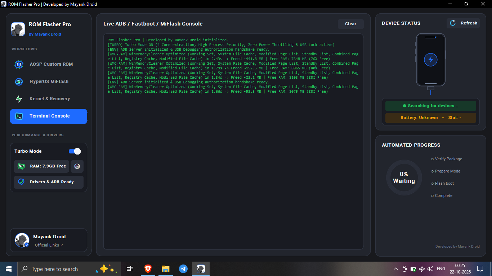
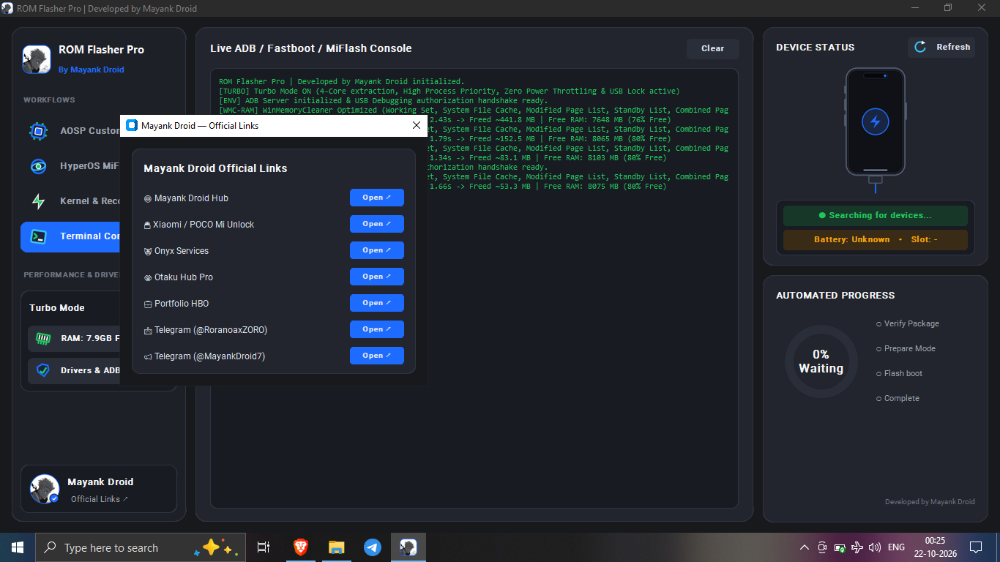

<div align="center">
  
  <br>
  

  # ROM FLASHER PRO · V6.0.0
  **Android flashing toolkit for Windows · By Mayank Droid**

  [](https://github.com/xboyrex/ROM-Flasher-Pro-by-Mayank-Droid/releases/latest)
  [](https://github.com/xboyrex/ROM-Flasher-Pro-by-Mayank-Droid/issues)
  [](https://github.com/xboyrex/ROM-Flasher-Pro-by-Mayank-Droid)

  **Verify the package. Confirm the device. Then flash.**

  [Download Latest Release](https://github.com/xboyrex/ROM-Flasher-Pro-by-Mayank-Droid/releases/latest) · [Project Website](https://mayank-droid.pages.dev/) · [Report a Bug](https://github.com/xboyrex/ROM-Flasher-Pro-by-Mayank-Droid/issues)
</div>

---

## Overview

ROM Flasher Pro is presented as a Windows desktop utility for Android firmware workflows. Its interface groups AOSP/custom ROM, Xiaomi HyperOS/MIUI, kernel/recovery, terminal, device-status, progress, driver readiness and Windows memory-optimization controls into a single workspace.

> **Repository status:** the tracked repository contains documentation, UI assets, screenshots and release metadata. It does **not** currently contain the original application source tree or the Windows executable itself. The website and documentation redesign in this package does not modify or independently verify the behavior of the compiled application.

## Interface tour

<table>
  <tr><td width="50%"><br><b>01 · AOSP / Custom ROM</b><br>Firmware selection, partition controls and Auto Flash entry point.</td><td width="50%"><br><b>02 · HyperOS / MIUI MiFlash</b><br>ROM archive/folder selection, script modes and ARB Guard.</td></tr>
  <tr><td><br><b>03 · Kernel & Recovery</b><br>ZIP/IMG selection and target partition choices.</td><td><br><b>04 · Terminal Console</b><br>ADB/Fastboot/MiFlash-labelled output and clear control.</td></tr>
  <tr><td><br><b>05 · Official Links</b><br>Quick access to project and community destinations.</td><td><br><b>06 · RAM Cleaner</b><br>Physical RAM display, memory-area checklist and optimization action.</td></tr>
</table>

## Workspaces and visible controls

| Workspace | Visible interface areas |
|---|---|
| **AOSP / Custom ROM** | Firmware ZIP/IMG selection, Fastboot partition checklist, Auto Flash entry point, destructive-action controls and reboot controls |
| **HyperOS / MIUI MiFlash** | Fastboot ROM archive/folder or Recovery ZIP selector, Clean All / Save User Data / Clean All & Lock modes, ARB Guard toggle |
| **Kernel & Recovery** | ZIP/IMG selector, target partition choices such as `boot`, `recovery`, `init_boot`, `vendor_boot` and `dtbo` |
| **Terminal Console** | Application-reported ADB/Fastboot/MiFlash output, Clear control and device-status side panel |
| **Device Status** | Device search status, Refresh control, battery/slot fields and an automated progress ring |
| **RAM Cleaner / Windows Memory Cleaner** | Physical RAM summary, memory-area checkboxes and Optimize Memory Now action |
| **Drivers & ADB** | Driver/ADB readiness indicator |
| **Official Links** | Project, service and Telegram shortcuts |

### RAM Cleaner: what the screenshot shows

The screenshot shows a **Windows memory-optimization dialog** with native-API-labelled controls. Visible memory areas include Combined Page List, Modified File Cache, Modified Page List, Registry Cache, Standby List, Low Priority Standby List, System File Cache and Working Set. The presence of a control does not independently prove the cleaner's effect on every Windows build.

Memory optimization is not a replacement for sufficient RAM, closing memory-heavy applications or fixing a software leak. Save work before use and review the selected areas. Avoid claims that this can permanently “boost” every PC.

## Download and verify

1. Open the [official GitHub Releases page](https://github.com/xboyrex/ROM-Flasher-Pro-by-Mayank-Droid/releases/latest).
2. Confirm the release version and asset name before downloading.
3. Download the checksum manifest that corresponds to the same release asset, if published.
4. Calculate the local SHA-256 and compare it with the expected hash for that exact file.

**Windows PowerShell**

```powershell
Get-FileHash .\ROM_Flasher_Pro_By_Mayank_Droid.exe -Algorithm SHA256
```

**Termux / Linux**

```bash
sha256sum ROM_Flasher_Pro_By_Mayank_Droid.exe
```

A matching checksum checks integrity against the supplied manifest; it does not by itself prove that a program is safe or trustworthy. Do not compare an old hash against a newly downloaded build unless the release explicitly maps them.

## Before you flash

- [ ] Back up important data and confirm the backup can be restored.
- [ ] Check the exact device model, codename, region, Android version and slot state.
- [ ] Confirm the firmware is intended for the exact device and follows trusted device-specific instructions.
- [ ] Check release notes and published hashes before running the executable.
- [ ] Use a reliable USB cable/port and appropriate OEM drivers.
- [ ] Understand whether a mode wipes userdata or changes bootloader lock state.
- [ ] Do not relock the bootloader after flashing unless the installed firmware is verified as correct for the exact device/region.
- [ ] Stop when the model, package, partition or instructions do not agree.

## Troubleshooting

**The phone is not detected** — confirm cable and USB port, select the correct phone mode (ADB or Fastboot), check platform-tools and OEM driver installation, and refresh the device status.

**Battery or slot shows Unknown** — the app may not be receiving compatible device information, or the phone may not be in a supported mode. Do not infer the battery/slot value.

**A flash operation fails** — do not blindly rerun it. Preserve the terminal output; confirm model/codename, firmware integrity, partition choice and bootloader state; then follow trusted device-specific recovery guidance.

**Windows displays a security warning** — unsigned or unfamiliar executables can trigger warnings. Do not bypass them unless you independently trust the source and have verified the artifact.

**RAM Cleaner does not improve performance** — memory reclaim may be temporary and can cause cache rebuild work. Close unnecessary apps and investigate the actual memory pressure rather than repeatedly running cleaners.

## Project structure

```text
.
├── assets/                 # Logo, brand mark, banner and SVG icon set
├── docs/                   # Setup, verification, UI guide and screenshots
├── scripts/                # Checksum verification helper
├── website/                # Responsive static site, CSS, JS, assets and gallery
├── tests/                  # Static project integrity tests
├── CHANGELOG.md
├── RELEASE_NOTES.md
├── VERSION
└── README.md
```

## Website preview and deployment

Open `website/index.html` directly for a local preview. No package manager or build step is required. For Cloudflare Pages, set the project root/build output to the `website/` directory and leave the build command empty. See [`website/DEPLOY.md`](website/DEPLOY.md).

## Safety disclaimer

Android flashing, erasing partitions and bootloader operations can permanently erase data or leave a device unbootable. Select only packages intended for the exact device, inspect every prompt and follow trusted device-specific documentation. RAM optimization can change system responsiveness and is not guaranteed to improve performance. This repository documentation is informational and is not a warranty that any operation is safe on every system.

## Links

- [Latest release](https://github.com/xboyrex/ROM-Flasher-Pro-by-Mayank-Droid/releases/latest)
- [All releases](https://github.com/xboyrex/ROM-Flasher-Pro-by-Mayank-Droid/releases)
- [Source repository](https://github.com/xboyrex/ROM-Flasher-Pro-by-Mayank-Droid)
- [Issue tracker](https://github.com/xboyrex/ROM-Flasher-Pro-by-Mayank-Droid/issues)
- [Mayank Droid YouTube](https://youtube.com/@mayankdroid)
- [Mayank Droid Telegram](https://t.me/MayankDroid7)

<div align="center">
  <br>
  **ROM FLASHER PRO · MAYANK DROID**<br>
  <sub>CYAN × VIOLET · VERIFY BEFORE YOU FLASH</sub>
</div>
