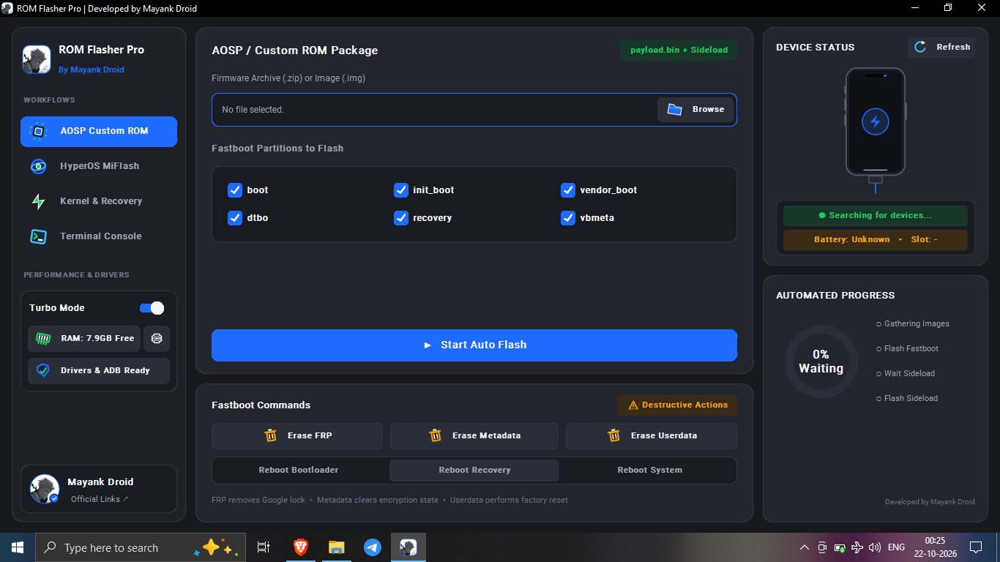
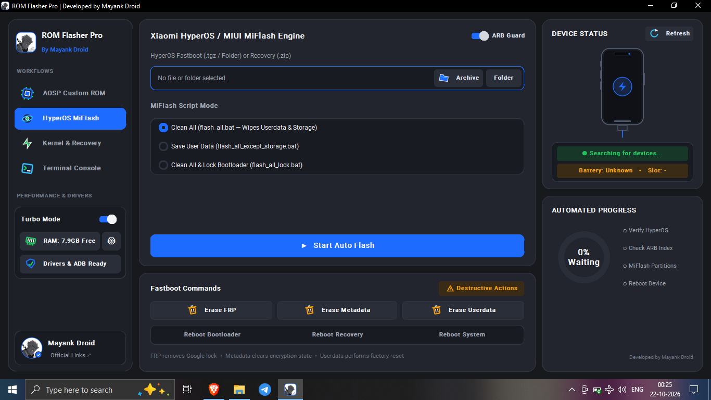
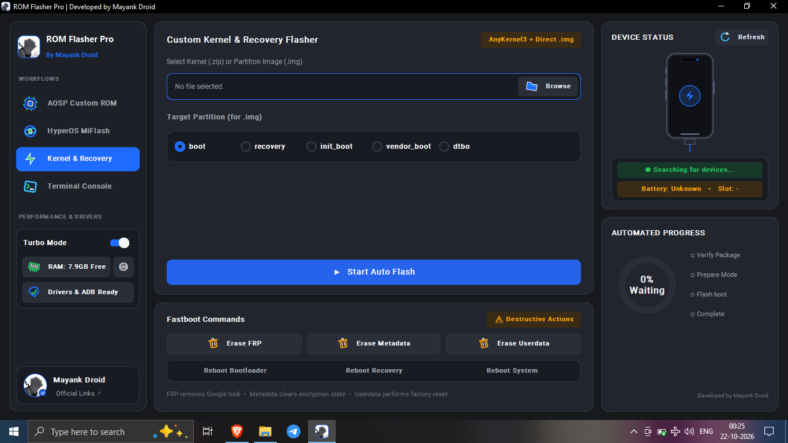
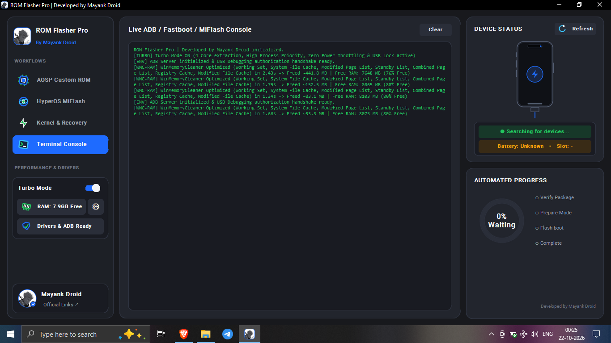
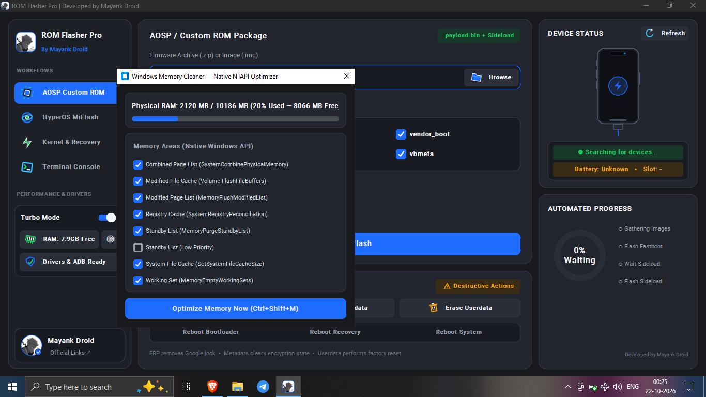

<div align="center">


# ROM FLASHER PRO

**V6.0.0 · CYBERPUNK EDITION · BY MAYANK DROID**


[**LATEST RELEASE**](https://github.com/xboyrex/ROM-Flasher-Pro-by-Mayank-Droid/releases/latest) · [PROJECT WEBSITE](https://mayank-droid.pages.dev/) · [ISSUES](https://github.com/xboyrex/ROM-Flasher-Pro-by-Mayank-Droid/issues)

<sub>VERIFY THE PACKAGE. CONFIRM THE DEVICE. THEN FLASH.</sub>

</div>

---

##  Overview

ROM Flasher Pro is presented as a Windows desktop toolkit interface for Android ROM, Fastboot, HyperOS/MIUI, kernel/recovery and device-maintenance workflows. Its interface brings device status, console output, workflow progress, driver readiness and Windows memory-optimization controls into one workspace.

> **Project status:** this repository contains documentation, UI assets, screenshots and release metadata. The original application source tree and the compiled Windows executable are not tracked in the repository; the executable is distributed through GitHub Releases. The interface shown in screenshots does not independently prove that every operation works on every device or Windows build.

##  Interface preview

<table>
<tr>
<td width="50%" valign="top"><a href="docs/readme-screenshots/aosp-custom-rom.png"></a><br /><strong>AOSP / Custom ROM</strong><br /><sub>Firmware selection and Fastboot partition controls.</sub></td>
<td width="50%" valign="top"><a href="docs/readme-screenshots/hyperos-miui.png"></a><br /><strong>HyperOS / MIUI</strong><br /><sub>ROM selection, script modes and ARB Guard.</sub></td>
</tr>
<tr>
<td width="50%" valign="top"><a href="docs/readme-screenshots/kernel-recovery.png"></a><br /><strong>Kernel &amp; Recovery</strong><br /><sub>ZIP/IMG selection and target partition.</sub></td>
<td width="50%" valign="top"><a href="docs/readme-screenshots/terminal-console.png"></a><br /><strong>Terminal Console</strong><br /><sub>Application-reported ADB/Fastboot/MiFlash output.</sub></td>
</tr>
<tr>
<td width="50%" valign="top"><a href="docs/readme-screenshots/ram-cleaner.png"></a><br /><strong>RAM Cleaner</strong><br /><sub>RAM summary and memory-area controls.</sub></td>
<td width="50%" valign="top"><a href="docs/readme-screenshots/official-links.png"></a><br /><strong>Official Links</strong><br /><sub>Project, service and community shortcuts.</sub></td>
</tr>
</table>

<sub>Select any screenshot to open the full-size image.</sub>

##  Workspaces

| Module | Visible controls and purpose |
|---|---|
| **AOSP / Custom ROM** | Firmware ZIP/IMG selection, Fastboot partition checklist, Auto Flash entry point and reboot controls. |
| **HyperOS / MIUI** | Fastboot ROM archive/folder or Recovery ZIP, Clean All / Save User Data / Clean All & Lock modes, ARB Guard. |
| **Kernel & Recovery** | ZIP/IMG selector and partitions including `boot`, `recovery`, `init_boot`, `vendor_boot` and `dtbo`. |
| **Terminal Console** | Application-reported ADB/Fastboot/MiFlash output and a clear control. |
| **Device Status** | Device search status, Refresh control, battery/slot fields and workflow progress indicator. |
| **RAM Cleaner** | Physical RAM display, memory-area checklist and an Optimize Memory Now action. |
| **Drivers & ADB** | Driver and ADB readiness indicator. |

##  RAM Cleaner notes

The screenshot shows a Windows memory-optimization panel with native-API-labelled controls. Visible areas include Combined Page List, Modified File Cache, Modified Page List, Registry Cache, Standby List, Low Priority Standby List, System File Cache and Working Set.

Memory optimization does not guarantee higher performance or permanently increase available RAM. Save open work, review selected areas and close unnecessary applications first. The actual result depends on the implementation and Windows environment.

##  Downloads and verification

<div align="center">

[](https://github.com/xboyrex/ROM-Flasher-Pro-by-Mayank-Droid/releases/latest)
[](https://github.com/xboyrex/ROM-Flasher-Pro-by-Mayank-Droid/releases)

</div>

1. Open the official Releases page and confirm the version and exact asset filename.
2. Download the checksum manifest for that same release, if one is provided.
3. Calculate the local SHA-256 and compare it to the published value for the exact asset.

**Windows PowerShell**

```powershell
Get-FileHash .\ROM_Flasher_Pro_V6.exe -Algorithm SHA256
```

**Termux / Linux**

```bash
sha256sum ROM_Flasher_Pro_V6.exe
```

A matching hash verifies file consistency against the supplied manifest; it does not independently prove that an executable is safe or trustworthy.

##  Pre-flash checklist

- [ ] Back up important data and verify that the backup is usable.
- [ ] Confirm the exact phone model, codename, region, Android version and slot state.
- [ ] Verify that the package is intended for the exact device variant.
- [ ] Check the release notes, file integrity and trusted device-specific instructions.
- [ ] Use an adequate battery level, reliable USB cable and correct drivers.
- [ ] Understand whether a mode wipes userdata or changes bootloader lock state.
- [ ] Never relock a bootloader unless firmware compatibility for that exact device and region is confirmed.
- [ ] Stop if the model, package, partition or instruction does not match.

##  Troubleshooting

<details>
<summary><strong>Device not detected</strong></summary>

Check the USB cable and port, choose the correct ADB or Fastboot mode, confirm OEM driver and platform-tools installation, then refresh device status.

</details>

<details>
<summary><strong>Battery or slot appears as Unknown</strong></summary>

Compatible device information may be unavailable, or the phone may be in an unsupported mode. Do not infer a value that the application has not detected.

</details>

<details>
<summary><strong>Flash operation fails</strong></summary>

Do not repeatedly retry blindly. Preserve the console output, verify the model/codename, firmware integrity, partition choice and bootloader state, then follow trusted device-specific recovery documentation.

</details>

<details>
<summary><strong>Windows security warning</strong></summary>

Unsigned or unfamiliar executables can trigger warnings. Do not bypass them unless you independently trust the publisher and have verified the artifact.

</details>

<details>
<summary><strong>RAM Cleaner does not improve performance</strong></summary>

Reclaiming memory can be temporary and can cause cached data to be rebuilt. Close unnecessary applications and investigate actual memory pressure instead of repeatedly running cleaners.

</details>

##  Official portals

<details>
<summary><strong>Websites and services</strong></summary>

| Site | Link |
|---|---|
| Mayank Droid Hub | [mayank-droid.pages.dev](https://mayank-droid.pages.dev/) |
| Portfolio | [portfolio-hbo.pages.dev](https://portfolio-hbo.pages.dev/) |
| Onyx Services | [onyx-services.pages.dev](https://onyx-services.pages.dev/) |
| Otaku Hub Pro | [otaku-hub-pro.pages.dev](https://otaku-hub-pro.pages.dev/) |
| Mi Unlock | [mi-unlock.pages.dev](https://mi-unlock.pages.dev/) |
| Mi Unlock backup | [mi-unlock.xboyrex496.workers.dev](https://mi-unlock.xboyrex496.workers.dev/) |

</details>

<details>
<summary><strong>GitHub projects</strong></summary>

| Project | Link |
|---|---|
| Developer profile | [github.com/xboyrex](https://github.com/xboyrex) |
| ROM Flasher Pro · current repository | [ROM-Flasher-Pro-by-Mayank-Droid](https://github.com/xboyrex/ROM-Flasher-Pro-by-Mayank-Droid) |
| ROM Flasher Pro | [ROM-Flasher-Pro](https://github.com/xboyrex/ROM-Flasher-Pro) |
| ROM Flasher Onyx v5 | [ROM-Flasher-Onyx](https://github.com/xboyrex/ROM-Flasher-Onyx) |
| Bootloader Unlocker v6 | [Mayank_Droid_Bootloader_Unlocker_v6](https://github.com/xboyrex/Mayank_Droid_Bootloader_Unlocker_v6) |

</details>

<details>
<summary><strong>Telegram channels and contact</strong></summary>

| Channel / Contact | Link |
|---|---|
| Mayank Droid | [@MayankDroid7](https://t.me/MayankDroid7) |
| Personal / service contact | [@RoranoaxZORO](https://t.me/RoranoaxZORO) |
| Onyx community | [@OnyxHub7](https://t.me/OnyxHub7) |
| InstaFlux updates | [@instafluxofficial](https://t.me/instafluxofficial) |
| ST Insta updates | [@STinsta_official](https://t.me/STinsta_official) |
| Apps2App updates | [@Apps2App_Com](https://t.me/Apps2App_Com) |

</details>

<details>
<summary><strong>YouTube and Instagram</strong></summary>

| Channel | Link |
|---|---|
| YouTube · Mayank Droid | [youtube.com/@mayankdroid](https://youtube.com/@mayankdroid) |
| YouTube · Onyx Droid | [youtube.com/@onyxdroid89](https://youtube.com/@onyxdroid89) |
| Instagram · Main | [@mayank.droid](https://www.instagram.com/mayank.droid/) |
| Instagram · Alternate | [@mayank.zx7](https://www.instagram.com/mayank.zx7/) |

</details>

<details>
<summary><strong>Selected videos</strong></summary>

- [Video 1](https://youtu.be/cJ6tt9qCuxM)
- [Video 2](https://youtu.be/9Er0LKIgGlc)
- [Video 3](https://youtu.be/ztjcEffLY3c)
- [Video 4](https://youtu.be/5a1OmJuzU2o)
- [Video 5](https://youtu.be/s_fo9-PVpws)
- [YouTube Short](https://youtube.com/shorts/XU0my1GGhIQ)
- [Instagram Reel](https://www.instagram.com/reel/DdRIgHssnFM/)

</details>

##  Repository structure

```text
.
├── assets/
│   ├── icons/                 # Local SVG icon set
│   ├── cyberpunk-banner.gif   # Original animated README banner
│   ├── cyberpunk-banner.png   # Static banner fallback
│   ├── logo.png               # Existing repository logo
│   ├── mark.svg
│   └── rom-flasher-banner.svg
├── docs/
│   └── readme-screenshots/   # Named application screenshots
├── scripts/                  # Existing verification helpers
├── website/                  # Static project website
├── CHANGELOG.md
├── RELEASE_NOTES.md
├── VERSION
└── README.md
```

##  Project links

[Repository](https://github.com/xboyrex/ROM-Flasher-Pro-by-Mayank-Droid) · [Latest release](https://github.com/xboyrex/ROM-Flasher-Pro-by-Mayank-Droid/releases/latest) · [Issues](https://github.com/xboyrex/ROM-Flasher-Pro-by-Mayank-Droid/issues) · [Website](https://mayank-droid.pages.dev/)

##  Safety notice

Android flashing, partition erasure and bootloader changes can permanently erase data or leave a device unbootable. Use firmware for the exact device variant and follow trusted instructions. RAM optimization can change system responsiveness and is not guaranteed to improve performance. This README documents the visible project interface and is not a warranty that any operation is safe on every system.

<div align="center">


**ROM FLASHER PRO · MAYANK DROID**

<sub>CYAN × VIOLET · ANIME CYBERPUNK · VERIFY BEFORE YOU FLASH</sub>

</div>
