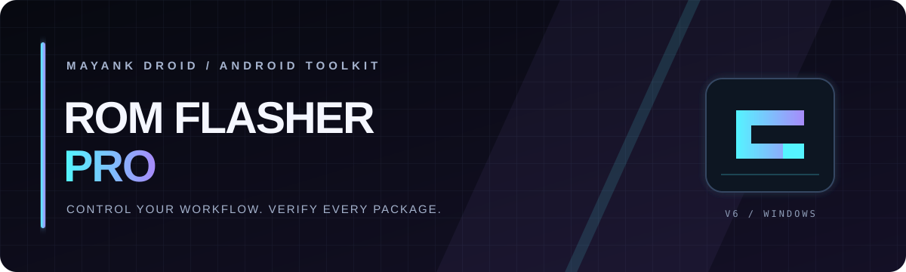
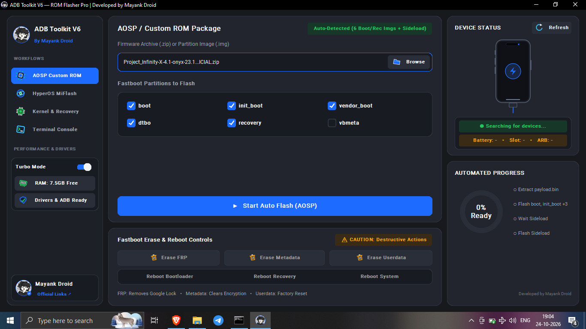
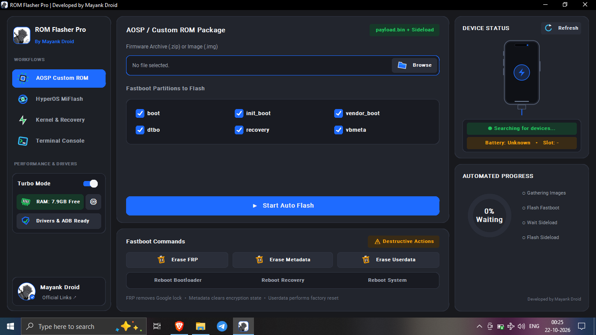

<div align="center">



# ROM FLASHER PRO · V6.0.0
### ANDROID FLASHING TOOLKIT FOR WINDOWS

**One workspace for ROM workflows, device checks, terminal visibility and memory tools.**  
*Verify the device. Verify the package. Then flash.*

[](https://github.com/xboyrex/ROM-Flasher-Pro-by-Mayank-Droid/releases/latest)
[](https://github.com/xboyrex/ROM-Flasher-Pro-by-Mayank-Droid/issues)

[**DOWNLOAD LATEST RELEASE**](https://github.com/xboyrex/ROM-Flasher-Pro-by-Mayank-Droid/releases/latest) · [WEBSITE](https://mayank-droid.pages.dev/) · [SOURCE CODE](https://github.com/xboyrex/ROM-Flasher-Pro-by-Mayank-Droid) · [REPORT A BUG](https://github.com/xboyrex/ROM-Flasher-Pro-by-Mayank-Droid/issues)

</div>

---

## At a glance

| Workspace | What the interface shows |
|---|---|
| **AOSP / Custom ROM** | Firmware ZIP/IMG selection, Fastboot partition checkboxes and Auto Flash entry point |
| **HyperOS / MIUI MiFlash** | Fastboot ROM archive/folder or Recovery ZIP, MiFlash script modes and ARB Guard toggle |
| **Kernel & Recovery** | ZIP/IMG selection, target partition choices and Fastboot command controls |
| **Terminal Console** | ADB / Fastboot / MiFlash-labelled workflow output and Clear control |
| **Device Status** | Device-search status, battery/slot fields and manual Refresh control |
| **Automated Progress** | Progress ring and workflow-stage checklist |
| **Turbo Mode & RAM Cleaner** | Turbo Mode toggle, RAM availability display, memory-area checklist and optimization action |
| **Drivers & ADB** | Driver/ADB readiness indicator |
| **Official Links** | Mayank Droid Hub, Xiaomi / POCO Mi Unlock, Onyx Services, Otaku Hub Pro and Telegram shortcuts |

> **Accuracy note:** Screenshots document visible interface controls. Device detection, flashing, memory optimization and other actions depend on the installed build, permissions, drivers, device state and implementation. A UI label alone does not prove an operation succeeded.

## Application screenshots

### 1. AOSP / Custom ROM
Choose the firmware archive or image, review the Fastboot partitions shown in the UI, and use workflow controls only after confirming device and package compatibility.



### 2. Xiaomi HyperOS / MIUI MiFlash
The interface shows Fastboot ROM archive/folder or Recovery ZIP selection, MiFlash script modes (Clean All, Save User Data and Clean All & Lock Bootloader), plus ARB Guard.



### 3. Kernel & Recovery
The interface shows ZIP/IMG selection, target partitions such as boot, recovery, init_boot, vendor_boot and dtbo, a Start Auto Flash entry point and Fastboot command controls.


### 4. Terminal Console
A dedicated console view shows ADB / Fastboot / MiFlash-labelled output and a Clear control. Review logs and independently confirm the final device state.


### 5. Official Links
The dialog includes shortcuts to Mayank Droid Hub, Xiaomi / POCO Mi Unlock, Onyx Services, Otaku Hub Pro and Telegram destinations.


### 6. RAM Cleaner / Windows Memory Cleaner
The screenshot shows physical RAM usage, a memory-area checklist and an Optimize Memory Now action. Visible options include Combined Page List, Modified File Cache, Modified Page List, Registry Cache, Standby List, System File Cache and Working Set. One view also shows Low Priority Standby List unchecked.

Memory cleaning can affect responsiveness. It does not replace adding physical RAM or closing memory-heavy apps. Save work and review selected options before optimizing.


### 7. Additional application view


## Feature guide

### AOSP / Custom ROM
- Select the firmware archive or image presented by the interface.
- Review the partition list and select only partitions appropriate for the exact device and package.
- Treat **Start Auto Flash** as potentially destructive; read device-specific instructions first.

### Xiaomi HyperOS / MIUI
- Select a supported Fastboot ROM archive/folder or Recovery ZIP.
- **Clean All** is labelled as wiping userdata and storage.
- **Save User Data** is intended to preserve data, but preservation is not guaranteed.
- **Clean All & Lock Bootloader** can be dangerous if firmware is not correct for the exact device and region. Do not relock a bootloader with incompatible firmware.
- Check Anti-Rollback (ARB) requirements and device-specific guidance.

### Kernel & Recovery
- Choose the intended ZIP or IMG package.
- For IMG flashing, verify the target partition against trusted instructions for the exact device.
- Never guess a partition based only on a filename.

### Terminal, device status and progress
- Use the terminal to inspect application-reported output.
- Use Refresh when checking device status.
- Battery, slot and connection fields may remain unknown when no compatible device is detected or required tooling is unavailable.
- Progress indicators describe workflow state; independently confirm the final device state.

### Turbo Mode, RAM Cleaner and drivers
- The UI includes a Turbo Mode toggle, RAM availability display, memory-optimization settings and a Drivers & ADB readiness indicator.
- Save work before memory optimization. Do not run unfamiliar scripts as Administrator without reviewing their source.
- If ADB/Fastboot does not detect the phone, check cable/USB port, phone mode, OEM drivers and platform-tools installation.

## Download and verify

### [GET THE LATEST OFFICIAL RELEASE](https://github.com/xboyrex/ROM-Flasher-Pro-by-Mayank-Droid/releases/latest)

Download the executable and release notes from GitHub Releases. Check the exact asset name/version. If a matching SHA-256 checksum is published, verify the downloaded file:

```powershell
Get-FileHash .\ROM_Flasher_Pro_V6.exe -Algorithm SHA256
```

Compare it with the checksum published for that same release asset. A checksum from a different build is not a valid comparison.

## Before you flash
- [ ] Back up important files and verify the backup is accessible.
- [ ] Confirm exact phone model, codename, region and current software state.
- [ ] Confirm the ROM/package is intended for that exact device.
- [ ] Read release notes and device-specific instructions.
- [ ] Charge the phone and use a reliable USB cable and port.
- [ ] Install required OEM USB drivers and official ADB/Fastboot tools where needed.
- [ ] Understand whether the selected mode wipes data or changes bootloader lock state.
- [ ] Stop if device, package, partition or command does not match instructions.

## Requirements and troubleshooting
- **Windows desktop:** the project is presented as a Windows executable.
- **No device detected:** check cable/USB port, select the correct phone mode, confirm drivers, then refresh device status.
- **Unknown battery or slot:** compatible device information may be unavailable.
- **Flash failed:** do not repeatedly retry blindly. Record console output, confirm the exact model/package and follow trusted device-specific recovery guidance.
- **Memory cleaner:** close unnecessary applications first; optimization is not a substitute for diagnosing persistent RAM or performance issues.

## Official project links
- [Latest release](https://github.com/xboyrex/ROM-Flasher-Pro-by-Mayank-Droid/releases/latest)
- [All releases](https://github.com/xboyrex/ROM-Flasher-Pro-by-Mayank-Droid/releases)
- [Repository source](https://github.com/xboyrex/ROM-Flasher-Pro-by-Mayank-Droid)
- [Issues / bug reports](https://github.com/xboyrex/ROM-Flasher-Pro-by-Mayank-Droid/issues)
- [Documentation](https://github.com/xboyrex/ROM-Flasher-Pro-by-Mayank-Droid/tree/main/docs)
- [Changelog](https://github.com/xboyrex/ROM-Flasher-Pro-by-Mayank-Droid/blob/main/CHANGELOG.md)
- [Release notes](https://github.com/xboyrex/ROM-Flasher-Pro-by-Mayank-Droid/blob/main/RELEASE_NOTES.md)
- [Mayank Droid on YouTube](https://youtube.com/@mayankdroid)
- [Mayank Droid on Telegram](https://t.me/MayankDroid7)
- [Mona GitHub animation on Tenor](https://tenor.com/view/mona-github-loading-github-mona-gif-7739926769025390653)

## Safety disclaimer
Flashing firmware, erasing partitions, wiping userdata or changing bootloader state can permanently erase data or make a device unbootable. Follow trusted instructions for the exact device. Review all prompts and verify every package before proceeding.

<div align="center">


**ROM FLASHER PRO · MAYANK DROID**  
<sub>CYAN × PURPLE · VERIFY BEFORE YOU FLASH</sub>
</div>
