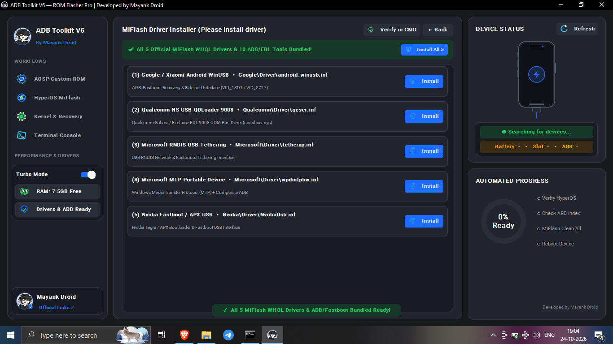

# ROM FLASHER PRO

**V6.1.0 · HOTFIX EDITION · MAYANK DROID**

[**LATEST RELEASE**](https://github.com/xboyrex/ROM-Flasher-Pro-by-Mayank-Droid/releases/latest) · [CHANGELOG](CHANGELOG.txt) · [FLASHING GUIDE](INSTRUCTIONS.txt) · [PROJECT WEBSITE](https://mayank-droid.pages.dev/) · [ISSUES](https://github.com/xboyrex/ROM-Flasher-Pro-by-Mayank-Droid/issues)

VERIFY THE PACKAGE. CONFIRM THE DEVICE. REVIEW EACH DESTRUCTIVE ACTION.

---

> **Release coordination:** V6.1.0 documentation and screenshot updates are prepared in the default branch. The previously published Release page currently hosts `ADB_Toolkit_V6.exe` under the `v6.0.0` tag; publish a dedicated `v6.1.0` GitHub Release and attach the intended binary before describing V6.1.0 as the latest downloadable release.

## Overview

ROM Flasher Pro is a Windows-facing Android servicing toolkit interface covering AOSP/custom-ROM workflows, Xiaomi HyperOS/MIUI MiFlash modes, kernel/recovery image selection, ADB/Fastboot diagnostics, driver installation/verification and Windows memory-optimization controls.

This repository currently contains the documentation, screenshots, visual assets, static website and release metadata. It **does not contain the original application source tree**. The hotfix notes below are consolidated from the supplied build/change log; they are not a substitute for an independent source audit or device-specific validation of the executable.

## V6.1.0 hotfix highlights

- **UI stability:** less redundant redraw work, more stable panel geometry, cleaner tab repainting and progress animation that runs when progress changes.
- **Device detection:** clearer ADB/Fastboot state handling, explicit refresh behavior and connection checks before device-dependent actions.
- **Package routing:** archive/image detection for `.zip`, `.tgz` and `.img` inputs, including payload-based AOSP detection and HyperOS/MIUI workflow selection.
- **Large sideload handling:** a chunked transfer path is reported for large ROM ZIPs, with cleaner ADB environment handling and less extraction noise in the console.
- **Driver workflow:** a consolidated driver panel and command-console verification for the bundled tools and driver groups.
- **Console quality:** read-only log output, clearer line separation, more useful wrapping and removal of repeated log prefixes.
- **RAM Cleaner:** the supplied build notes describe ten memory-optimization stages, including heap/GC cleanup and temporary/USB-buffer cleanup.

See [CHANGELOG.txt](CHANGELOG.txt) for the detailed hotfix record and [INSTRUCTIONS.txt](INSTRUCTIONS.txt) for workflow-specific operating guidance.

## Interface gallery

Screenshots document the available interface and its visible controls; they do not independently verify that every operation succeeds on every device or Windows build.

<table>
<tr>
<td width="50%" valign="top"> <strong>01 / AOSP &amp; Custom ROM</strong> Firmware selection, payload-aware partition checklist and Auto Flash entry point.</td>
<td width="50%" valign="top"> <strong>02 / HyperOS &amp; MIUI</strong> Fastboot ROM/Recovery ZIP selection, script modes and ARB Guard.</td>
</tr>
<tr>
<td width="50%" valign="top"> <strong>03 / Kernel &amp; Recovery</strong> Image input and target-partition selection.</td>
<td width="50%" valign="top"> <strong>04 / Terminal &amp; Verification</strong> Command-style output and bundled-tool verification results.</td>
</tr>
<tr>
<td width="50%" valign="top"> <strong>05 / Driver Installation</strong> Driver groups with individual and combined installation controls.</td>
<td width="50%" valign="top"> <strong>06 / Console Workspace</strong> Terminal layout before command output is populated.</td>
</tr>
<tr>
<td width="50%" valign="top"> <strong>07 / Official Links</strong> Project and community shortcut panel.</td>
<td width="50%" valign="top"></td>
</tr>
</table>

## Functional areas

| Area | Visible workflow | Review before use |
|---|---|---|
| AOSP / Custom ROM | ZIP/IMG selection, payload partition list, Fastboot controls and Auto Flash | Confirm device codename, package integrity and required partitions. |
| HyperOS / MIUI MiFlash | Fastboot package or Recovery ZIP, script modes and ARB Guard | Confirm region/build and anti-rollback constraints. `Clean All` erases data; `Clean All & Lock` can brick a mismatched device. |
| Kernel & Recovery | Select an image and a target partition | Never infer the destination partition from a filename alone. |
| ADB / Fastboot console | Device state, console output, refresh and reboot controls | Verify connection state independently; console text is not proof of a successful flash. |
| Drivers & bundled tools | Driver installation controls and console verification | Install only trusted, compatible drivers and check the results. |
| RAM Cleaner | Memory display and optimization controls | Save work first. Cache cleanup may have temporary effects and is not guaranteed to improve responsiveness. |

## Installation and first run

1. Open the [GitHub Releases page](https://github.com/xboyrex/ROM-Flasher-Pro-by-Mayank-Droid/releases) and confirm the version and exact asset name.
2. Download the executable/package from the intended release. The executable is not tracked in this repository's source tree.
3. Verify the SHA-256 digest when a matching digest is published for that exact asset.
4. Install the appropriate OEM/ADB USB driver. Connect the phone using the mode required by the selected workflow.
5. Confirm the model, codename, region, bootloader state and firmware source before starting any flash operation.
6. Follow the complete [V6.1 instructions](INSTRUCTIONS.txt). Stop if the application status, partition list or device identity conflicts with trusted device-specific instructions.

## Release artifacts

- [Latest release](https://github.com/xboyrex/ROM-Flasher-Pro-by-Mayank-Droid/releases/latest)
- [All releases](https://github.com/xboyrex/ROM-Flasher-Pro-by-Mayank-Droid/releases)
- [V6.1 changelog (TXT)](CHANGELOG.txt)
- [V6.1 instructions (TXT)](INSTRUCTIONS.txt)
- [Application feature guide](docs/FEATURES.md)
- [Artifact verification](docs/VERIFICATION.md)

## Safety and scope

Flashing, partition erasure, data formatting and bootloader changes can cause irreversible data loss or leave a device unbootable. Back up important data, use firmware intended for the exact device variant and understand each command before authorizing it. Do not select `Clean All & Lock` unless trusted, device-specific release instructions explicitly permit relocking with that exact firmware. Do not use EDL/9008 flows outside an authorized and device-appropriate process.

The repository's screenshots show the user interface, not the application's source code or an assurance that each operation is safe on every model. Use device-specific maintainer instructions and independently verify the resulting device state.

**ROM FLASHER PRO · MAYANK DROID**

CYAN × VIOLET · WINDOWS · ANDROID SERVICING WORKFLOWS

[REPOSITORY](https://github.com/xboyrex/ROM-Flasher-Pro-by-Mayank-Droid) · [RELEASES](https://github.com/xboyrex/ROM-Flasher-Pro-by-Mayank-Droid/releases) · [ISSUES](https://github.com/xboyrex/ROM-Flasher-Pro-by-Mayank-Droid/issues)

